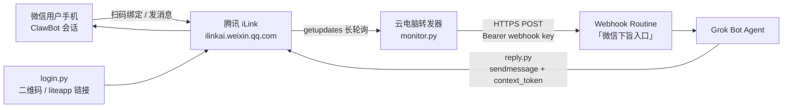

# Grok Bot 接入微信 ClawBot（iLink）完整实操教程

> 面向：**想复现整套链路的人**，以及 **能按文档逐步执行的 AI Agent**。  
> 性质：长文 README / 技术博客混合体；基于一次真实成功接线整理。  
> 安全：本文**不含**真实 Webhook URL、Webhook Key、`bot_token`、用户 ID。请用占位符自行替换。

---

## 目录（给人类与 AI 的导航）

1. [一句话结论](#一句话结论)
2. [架构总览](#架构总览)
3. [先决条件检查清单](#先决条件检查清单)
4. [核心概念](#核心概念)
5. [复现步骤（编号）](#复现步骤编号)
6. [脚本目录与职责](#脚本目录与职责)
7. [关键 HTTP 头与接口](#关键-http-头与接口)
8. [消息回路（收 → 醒 → 回）](#消息回路收--醒--回)
9. [运维与重启](#运维与重启)
10. [故障排查表](#故障排查表)
11. [安全注意事项](#安全注意事项)
12. [可复制提示词（焚决）](#可复制提示词焚决)
13. [FAQ：GitHub / 其他 AI 能否直接读本教程？](#faqgithub--其他-ai-能否直接读本教程)
14. [FAQ：还有哪些 AI 能接微信 ClawBot？](#faq还有哪些-ai-能接微信-clawbot)
15. [能力边界与合规](#能力边界与合规)
16. [给 AI Agent 的执行契约](#给-ai-agent-的执行契约)

---

## 一句话结论

通过腾讯官方 **微信 ClawBot** 插件 + **iLink**（`ilinkai.weixin.qq.com`）HTTP JSON 接口，在 **Grok Bot 云电脑**上跑一个**只出站**的转发器：`getupdates` 长轮询收消息 → POST 到名为「微信下旨入口」的 **Webhook Routine** → Agent 处理后用 `sendmessage` 以**纯文本**回微信。全程**不需要公网入站端口**。

---

## 架构总览



**数据流要点：**

| 方向 | 机制 | 是否需要公网端口 |
| --- | --- | --- |
| 微信 → Agent | 云电脑主动 `getupdates` 拉消息，再 POST webhook | 否（出站） |
| Agent → 微信 | 云电脑主动 `sendmessage` | 否（出站） |
| 登录 | `get_bot_qrcode` + `get_qrcode_status` | 否（出站） |

---

## 先决条件检查清单

在动手前逐项确认（建议 AI 执行时把本表当作 gate）：

- [ ] 微信客户端版本：**iOS ≥ 8.0.70** 或 **Android ≥ 8.0.69**
- [ ] 已在微信中启用插件：**我 → 设置 → 插件 → 微信ClawBot**（红色小龙虾图标）
- [ ] 已阅读并接受微信侧《微信ClawBot功能使用条款》（以微信内展示为准）
- [ ] 拥有可用的 **Grok Bot** 账号与一台可执行 Python 的**云电脑**（box）
- [ ] 能在 Grok Bot 中创建 **Webhook 类型 Routine**
- [ ] 准备用 **加密表单 / secret form** 提交 Webhook URL 与 Key（**禁止**在聊天里粘贴明文密钥）
- [ ] 工作目录规划为：`/workspace/wechat-ilink`（或等价路径）
- [ ] Python 3 可用；可选虚拟环境 `.venv`
- [ ] 同一微信账号**不要**同时挂接多个会抢消息的 OpenClaw / 其它 iLink 客户端（否则会出现偶发无回复）

---

## 核心概念

### iLink / ClawBot

- **ClawBot**：微信官方插件，把个人微信会话接到 Bot 通道。
- **iLink**：腾讯提供的 Bot HTTP API 面，主域示例：`https://ilinkai.weixin.qq.com`。
- 登录成功后，状态里通常会有：`bot_token`、`baseurl`、`ilink_bot_id`、`ilink_user_id`（均属机密，勿提交仓库）。

### 只出站（outbound-only）

转发器**从不**在公网监听端口。它主动访问 iLink，并主动 POST 到 Grok Bot 的 Webhook。这对云电脑场景友好，也避免暴露入站面。

### Webhook Routine「微信下旨入口」

- 类型：`webhook` 触发的 Routine。
- 作用：把微信入站 JSON 变成一次 Agent 唤醒。
- 用户从 Routine 面板复制 **Webhook URL** 与 **sender key**，经 secret form 写入环境变量（例如 `WECHAT_WAKE_WEBHOOK_URL` / `WECHAT_WAKE_WEBHOOK_KEY`），脚本读取环境变量，**聊天记录中不出现明文**。

### `context_token`

- 来自**用户发给 ClawBot 的入站消息**。
- **回复必须原样回传**；没有它，`sendmessage` 无法正确投递。
- 因此：**绑定后第一句话必须由用户发出**，用来拿到首个 `context_token`。
- iLink **不能**让 Bot 在无上下文时主动冷启动推送营销消息。

### 关键请求头（踩坑点）

调用已登录接口（尤其 `getupdates`）时，至少应带：

| Header | 示例值 | 说明 |
| --- | --- | --- |
| `Content-Type` | `application/json` | JSON body |
| `AuthorizationType` | `ilink_bot_token` | **必填**；缺失时 `getupdates` 常见 `errcode: -14` / `session timeout` |
| `Authorization` | `Bearer <bot_token>` | 扫码确认后获得 |
| `iLink-App-Id` | `bot`（本实现） | 与 OpenClaw 插件的 `ilink_appid` 同类字段 |
| `iLink-App-ClientVersion` | 如 `132106`（对应 channel `2.4.10` 的 uint32 编码） | 客户端版本编码 |
| `X-WECHAT-UIN` | 随机 uint32 的十进制字符串再 Base64 | 官方插件惯例 |

> 实测：缺少 `AuthorizationType: ilink_bot_token` 时，`getupdates` 返回 **errcode -14（session timeout）**，表现与凭证失效类似，容易误判为「要重新扫码」。应先检查请求头。

---

## 复现步骤（编号）

下列步骤按真实成功路径排序。人类可逐步点选；AI 应按序执行并在需要人工处停下。

### 步骤 0 — 建工作区

```bash
mkdir -p /workspace/wechat-ilink/{scripts,state,logs,docs}
cd /workspace/wechat-ilink
python3 -m venv .venv
# 按需安装依赖（如 pillow / qrcode 仅当要本地画码时）
```

权限建议：`state/session.json` 写成后 `chmod 600`。

### 步骤 1 — 创建 Webhook Routine

1. 在 Grok Bot 中新建 Routine，名称建议：`微信下旨入口`。
2. 触发器选 **webhook**。
3. 保存后，到 Routine 面板复制：
   - Webhook URL → 记为 `WECHAT_WAKE_WEBHOOK_URL`
   - Webhook Key → 记为 `WECHAT_WAKE_WEBHOOK_KEY`
4. **立即**通过加密弹框 / secret form 交给 Agent；**不要**粘贴进聊天。
5. 确认界面提示类似「已安全保存并保持私密」。

Routine 被唤醒时应收到 JSON，字段概念如下（值均为示例占位）：

```json
{
  "source": "wechat_ilink",
  "text": "<用户纯文本>",
  "from_user_id": "<REDACTED_ILINK_USER_ID>",
  "context_token": "<REDACTED_CONTEXT_TOKEN>",
  "ilink_bot_id": "<REDACTED_BOT_ID>",
  "captured_at": "2026-10-11T04:07:08Z",
  "raw_message_type": 2
}
```

Agent 处理完后调用回复脚本（见步骤 5），并可选在主会话同步一份摘要。

### 步骤 2 — 部署转发脚本

在 `/workspace/wechat-ilink/scripts/` 放置四个脚本（概念职责见下一节）：

- `ilink_common.py` — 公共 HTTP / 会话 / webhook
- `login.py` — 取码、轮询确认、写 `state/session.json`
- `monitor.py` — 长轮询 `getupdates`，过滤绑定用户，POST webhook
- `reply.py` — 带 `context_token` 发纯文本

环境变量（由 secret form 注入，勿写入仓库）：

```bash
export WECHAT_WAKE_WEBHOOK_URL="https://example.invalid/webhook/<REDACTED>"
export WECHAT_WAKE_WEBHOOK_KEY="<REDACTED_KEY>"
```

### 步骤 3 — 手机侧启用 ClawBot

1. 升级微信到先决条件版本。
2. **我 → 设置 → 插件 → 微信ClawBot → 启用**。
3. 回到 Grok Bot 告知「插件已开好」，再继续登录。

### 步骤 4 — 扫码登录（或打开 liteapp 链接）

在云电脑执行（路径按实际调整）：

```bash
cd /workspace/wechat-ilink
source .venv/bin/activate   # 若使用 venv
python scripts/login.py
```

期望行为：

1. 调用 `GET/相关`：`/ilink/bot/get_bot_qrcode?bot_type=3`
2. 写出二维码图片到 `state/qr.png`（或等价）
3. 同时可提供 **微信内可打开的备用链接**，形态类似：  
   `https://liteapp.weixin.qq.com/q/<REDACTED>?qrcode=<REDACTED>&bot_type=3`  
   （完整 URL 含一次性参数，**不要**提交到公开仓库）
4. 轮询 `/ilink/bot/get_qrcode_status?qrcode=...`，直到 `confirmed`
5. 将 `bot_token` / `baseurl` / id 写入 `state/session.json`（权限 600）

用户操作：

- 用微信「扫一扫」扫 `qr.png`，或在微信内打开 liteapp 链接并确认。
- 二维码大约 **5 分钟**有效；超时重新跑 `login.py`。

### 步骤 5 — 启动 monitor，并让用户先发一句话

```bash
# 确保 webhook 环境变量已注入
python scripts/monitor.py >> logs/monitor.out 2>&1 &
```

然后用户在 **ClawBot 会话**里主动发第一句（任意内容）。  
`monitor.py` 应：

1. 从 `getupdates` 拿到消息与 `context_token`
2. 写入 `state/last_inbound.json`（勿把真实内容提交仓库）
3. POST 到「微信下旨入口」；HTTP 200 且 body 含 success 即唤醒成功

Agent 回复示例（占位）：

```bash
python scripts/reply.py \
  --to "<REDACTED_ILINK_USER_ID>" \
  --context-token "<REDACTED_CONTEXT_TOKEN>" \
  --text "你好，已连通。请用纯文本继续吩咐。"
```

规则：

- **只处理绑定用户**；其它 `from_user_id` 记日志后忽略。
- 回复 **纯文本 only**：去掉 Markdown（`**`、`` ` `` 等），因微信侧不渲染。

### 步骤 6 — 验收

同时满足即成功：

1. 微信 ClawBot 会话收到纯文本回复  
2. Webhook Routine 有对应 run（或主聊天有同步）  
3. `logs/monitor.jsonl` 出现 `event: woke` 且 `http: 200`

---

## 脚本目录与职责

### 概念文件树（无密钥）

```text
/workspace/wechat-ilink/
├── docs/
│   └── grok-bot-wechat-ilink-tutorial.md   # 本教程
├── scripts/
│   ├── ilink_common.py    # headers / http_json / getupdates / send_text / wake_webhook
│   ├── login.py           # QR 登录状态机 → state/session.json
│   ├── monitor.py         # 长轮询 → webhook；写 last_inbound / cursor
│   └── reply.py           # CLI：--to --context-token --text
├── state/                 # 运行时状态（默认勿 git commit）
│   ├── session.json       # bot_token, baseurl, ids（机密）
│   ├── cursor.txt         # get_updates_buf 游标
│   ├── bound_user.txt     # 绑定用户 id
│   ├── last_inbound.json  # 最近一条入站（含 context_token）
│   ├── qr.png             # 当前登录码
│   ├── qr_link.txt        # liteapp 备用链接（机密级一次性）
│   └── login_status.json  # 登录进度
├── logs/
│   ├── monitor.jsonl      # 结构化事件
│   └── monitor.out        # 进程 stdout/stderr
└── .venv/                 # 可选
```

### 各脚本职责摘要

| 文件 | 输入 | 输出 | 失败信号 |
| --- | --- | --- | --- |
| `login.py` | 无（或 bot_type=3） | `session.json`、`qr.png` | exit 非 0；status expired/timeout |
| `monitor.py` | `session.json` + webhook env | `cursor.txt`、`last_inbound.json`、jsonl | exit 14 → -14 过期；缺 env → `missing_webhook_env` |
| `reply.py` | `--to` `--context-token` `--text` | stdout JSON `{ok, ret, ...}` | exit 14 → -14 |
| `ilink_common.py` | 被 import | 统一 headers / HTTP | 网络错误 `network_error:...` |

### `ilink_common.headers` 伪代码（可对照实现）

```python
headers = {
    "Content-Type": "application/json",
    "AuthorizationType": "ilink_bot_token",  # 缺了会 -14
    "iLink-App-Id": "bot",
    "iLink-App-ClientVersion": "132106",     # 与 channel_version 编码一致
    "User-Agent": "GrokBot-WeChatBridge/1.0",
    "X-WECHAT-UIN": base64(str(random_uint32)),
}
if token:
    headers["Authorization"] = f"Bearer {token}"
```

---

## 关键 HTTP 头与接口

登录固定面（扫码前后，base 常用 `https://ilinkai.weixin.qq.com`）：

| 方法 | 路径 | 作用 |
| --- | --- | --- |
| （实现中为 GET 查询） | `/ilink/bot/get_bot_qrcode?bot_type=3` | 取二维码会话 |
| GET | `/ilink/bot/get_qrcode_status?qrcode=...` | 轮询 scan → confirmed；拿到 `bot_token` |
| POST | `{baseurl}/ilink/bot/getupdates` | 长轮询收消息；body 含 `get_updates_buf` 游标 |
| POST | `{baseurl}/ilink/bot/sendmessage` | 回复；`msg.context_token` 必填 |

`getupdates` body 概念：

```json
{
  "get_updates_buf": "<cursor or empty>",
  "base_info": {
    "channel_version": "2.4.10",
    "bot_agent": "GrokBot/1.0.0"
  }
}
```

`sendmessage` 文本消息概念（简化）：

```json
{
  "msg": {
    "from_user_id": "",
    "to_user_id": "<REDACTED>",
    "client_id": "grokbot-<uuid>",
    "message_type": 2,
    "message_state": 2,
    "context_token": "<FROM_INBOUND>",
    "item_list": [
      { "type": 1, "text_item": { "text": "纯文本回复" } }
    ]
  },
  "base_info": {
    "channel_version": "2.4.10",
    "bot_agent": "GrokBot/1.0.0"
  }
}
```

公开生态参考（勿发明未文档化私有 API）：

- npm / GitHub：`@tencent-weixin/openclaw-weixin`（OpenClaw 官方微信渠道插件）
- 社区封装示例名：`grok-wechat-plugin`（工具名因项目而异，以该仓库 README 为准）

---

## 消息回路（收 → 醒 → 回）

1. **收**：`monitor.py` 对 `{baseurl}/ilink/bot/getupdates` 长轮询（约数十秒一级；超时空转属正常）。  
2. **过滤**：若已绑定用户，忽略其它 `from_user_id`。  
3. **醒**：`wake_webhook(payload)` → `POST` Routine，Header 同时可带 `Authorization: Bearer <key>` 与 `X-Webhook-Key`（以实现为准）。  
4. **想**：Routine 保存的 prompt 驱动 Grok Bot 调用技能 / 云电脑。  
5. **回**：`reply.py` → `sendmessage`，**必须**携带最近入站的 `context_token`；文本去 Markdown。  
6. **游标**：把响应里的 `get_updates_buf` 写入 `state/cursor.txt`，断线可续。

---

## 运维与重启

### 云电脑重启后

进程不会自动复活（除非你另做了 systemd / 监督脚本）。重启后需要：

1. 确认 `state/session.json` 仍在  
2. 重新注入 webhook 环境变量  
3. 重新启动：`python scripts/monitor.py`  
4. 用一条微信消息做冒烟测试

### 凭证过期（-14）

当 `getupdates` / `sendmessage` 返回 `errcode == -14` 或日志 `token_expired` / `session timeout`：

1. **先查**请求头是否包含 `AuthorizationType: ilink_bot_token`（缺头也会表现为 -14）  
2. 若头正确仍 -14：视为会话失效 → **重新跑 `login.py` 扫码**  
3. 更新 `session.json` 后重启 `monitor.py`  
4. 用户再发一条消息刷新 `context_token`

### 日志怎么读

`logs/monitor.jsonl` 事件名（概念）：

| event | 含义 |
| --- | --- |
| `start` | monitor 启动 |
| `woke` | 已 POST webhook；看 `http` 是否 200 |
| `token_expired` | -14 |
| `ignored_other_user` | 非绑定用户 |
| `poll_error` | 网络或其它轮询错误 |

---

## 故障排查表

| 现象 | 可能原因 | 处理 |
| --- | --- | --- |
| `getupdates` → `errcode: -14` / `session timeout` | 缺 `AuthorizationType`；或 `bot_token` 真过期 | 先补齐 headers；仍失败则重扫码 |
| 扫码后微信无回复 | `monitor` 未运行；webhook env 缺失；Routine 未启用 | 查进程、`missing_webhook_env`、Routine 面板 |
| webhook 非 200 | URL/key 错误或过期 | 用 secret form 重填；勿在聊天暴露 |
| 能唤醒但不回微信 | 缺少 `context_token`；或用了 Markdown/富文本 | 用户先发一句；`reply.py` 只发纯文本 |
| 有时回有时不回 | 同一微信挂了多个 iLink 客户端抢消息 | 只保留一条接收链路 |
| 二维码无效 | 超过约 5 分钟 | 重跑 `login.py` |
| 登录确认但无 `bot_token` | 状态未到 confirmed / 响应异常 | 看 `login_status.json`；重试扫码 |
| 云重启后全哑 | monitor 未拉起 | 按「运维与重启」拉起 |
| AI 在聊天里要密钥 | 违反安全流程 | 拒绝粘贴；改走 secret form |

---

## 安全注意事项

1. **永远不要**把 Webhook URL、Webhook Key、`bot_token`、完整 `context_token`、真实 `ilink_user_id` 写进聊天、Issue、截图或公开仓库。  
2. Webhook 凭据只用 **secret form / 加密弹框** 注入环境变量。  
3. `state/` 与 `logs/` 默认加入 `.gitignore`；若需分享日志，先脱敏。  
4. `session.json` 权限建议 `0600`。  
5. 绑定策略：**单用户白名单**（`bound_user.txt`）；忽略陌生人。  
6. 本通道适合个人助手场景；**不要**用于群发营销、骚扰或绕过平台条款的用途。  
7. 公开本教程时，只保留占位符与协议级说明，不附带一次性 QR 链接。

---

## 可复制提示词（焚决）

把下面整段发给你的 Grok Bot（Kin 风格「焚决」；可按需改名，但建议保留「微信下旨入口」以便对照本文）：

```text
我想把你接到我的微信上，让我能在微信里直接给你发消息、收到你的回复。
请按下面的思路做，每做完一步告诉我结果，需要我操作的地方停下来等我。

1、先调研方案：腾讯「微信ClawBot」插件用的是 iLink 接口
   （ilinkai.weixin.qq.com）。请确认怎么用 getupdates 长轮询收消息、
   怎么用 sendmessage 回消息。整个程序只走出站请求，不要开公网端口。

2、在 Grok Bot 里建一个由 webhook 触发的 routine，名字可以叫「微信下旨入口」。
   建好后告诉我去 routine 面板复制 Webhook URL 和 key，然后弹出加密弹框
   让我填进去，不要让我在聊天里发明文。

3、在你的云端电脑上写一个小转发程序：收到微信消息后 POST 给这个 routine；
   你处理完以后，用一个 reply 脚本把回复发回微信，同时在我们的主聊天里同步一份。

4、等我在手机微信里启用 ClawBot 插件以后，生成二维码让我用手机扫码确认，
   同时给我一个可以在微信里直接打开的备用链接。二维码大约 5 分钟有效。

5、绑定成功后，提醒我先在 ClawBot 对话里发一句话，因为回复要用到这条消息
   带的 context_token。

6、规则：只认绑定的这一个人，别人的消息不处理；回复一律用纯文本，不要用
   Markdown，因为微信不渲染 Markdown。

7、最后告诉我：云端电脑重启以后，怎么把转发程序重新拉起来；
   如果遇到错误码 -14（凭证过期），提醒我重新扫码。
   另外请确认请求头带上 AuthorizationType: ilink_bot_token，
   以及 iLink-App-Id / iLink-App-ClientVersion；缺 AuthorizationType 时
   getupdates 也会表现为 -14 session timeout。
```

---

## FAQ：GitHub / 其他 AI 能否直接读本教程？

**可以，前提是仓库/文件对它们可见。**

| 场景 | AI 是否容易直接读 | 说明 |
| --- | --- | --- |
| **Public** GitHub 仓库中的 `.md` | 是 | 爬虫、GitHub 索引、带浏览能力的 Agent 通常能拉取 |
| **Private** 仓库 | 否（除非已授权） | 需要登录 / PAT / 安装 App 等；未授权时 AI **不能**合法读取 |
| `raw.githubusercontent.com` / 仓库内 raw Markdown | 最理想 | 无多余 HTML 壳，结构清晰，利于 Agent 按标题与步骤执行 |
| 仅 Issues / Discussions 碎片 | 较差 | 上下文分散，不如单文件长文 |
| 本机未推送的文件 | 仅对持有该文件系统的 Agent | 例如 Grok Bot 云电脑上的 `/workspace/...`；GitHub 上的 AI 看不到，除非你 push |

**建议发布形态：**

- 路径示例：`docs/wechat-ilink-grok.md` 或仓库根 `README.md` 链到本文  
- 保持：**清晰 H2/H3、编号步骤、检查清单、表格、mermaid、可复制代码块**  
- 发布前再扫一遍，确认无真实 URL / token / 用户 id

诚实限制：即使文件公开，「能读到」≠「已内置进某模型的训练数据」；实时接入仍依赖该 AI 的联网 / 工具权限。

---

## FAQ：还有哪些 AI 能接微信 ClawBot？

它们大多共享**同一层 iLink 表面**，而不是各家私有未文档协议。以下为公开生态对照（不编造未公开 API）：

| 方案 | 典型位置 | 谁必须在线 | 备注 |
| --- | --- | --- | --- |
| **Grok Bot + 云电脑转发器 + Webhook Routine**（本文） | `/workspace/wechat-ilink` + Routine「微信下旨入口」 | Grok Bot 云 VM | 7×24；出站长轮询；适合「合上笔记本也能回」 |
| **OpenClaw + `@tencent-weixin/openclaw-weixin`** | 个人电脑 / 服务器上的 OpenClaw Gateway | **运行 Gateway 的那台机器** | 官方微信渠道插件；`openclaw channels login --channel openclaw-weixin`；机器休眠则通道停 |
| **社区 grok-wechat-plugin 等** | 视仓库而定 | 视宿主进程而定 | 常封装 login / inbox / send；以该项目 README 为准 |
| **本地 Claude / DeepSeek 等坐在 OpenClaw/ClawBot 后面** | 用户自建 Agent 接到 OpenClaw | 用户机器或自建服务器 | 模型可换；**通道层仍是 iLink + 宿主进程保活** |

**对比一句话：**

- **Grok Bot 路径**：通道驻留在云 VM + webhook 唤醒，强调常在线与密钥走 secret form。  
- **本地 OpenClaw 路径**：通道驻留在你的电脑/服务器；电脑休眠、Gateway 挂掉，微信侧就无人接听。  

安装官方插件的常见入口（以官方文档为准，版本会变）：

```bash
openclaw plugins install "@tencent-weixin/openclaw-weixin"
openclaw config set plugins.entries.openclaw-weixin.enabled true
openclaw channels login --channel openclaw-weixin
```

不要假设存在「未公开的腾讯专用 Claude API」；能复现的部分应能在 iLink / openclaw-weixin 公开说明里找到对应物。

---

## 能力边界与合规

- **私聊助手**场景为主；群聊能力以微信 / 插件当前声明为准（OpenClaw 插件元数据通常强调私信）。  
- **不能**在没有用户消息 / `context_token` 的情况下当作主动群发器。  
- **不要**走 itchat / iPad 协议 / 客户端 Hook 等非官方灰产路径；本教程只讨论官方 ClawBot + iLink。  
- 功能灰度、海外可用性以微信客户端实际展示为准。  
- 遵守微信条款与当地法律；密钥泄露应立刻轮换 Webhook key 并重新扫码。

---

## 给 AI Agent 的执行契约

若你是执行本教程的 Agent，请遵守：

1. **按章节顺序做**；每完成一步向用户汇报可验证结果（文件是否出现、HTTP 状态、errcode）。  
2. **需要用户操作时停下**：启用插件、复制 Webhook 字段、扫码、发送第一条微信消息。  
3. **密钥**：只通过 secret form；拒绝用户在聊天粘贴 key 时，引导改走表单，且不要把用户误粘贴的密钥回显或写入仓库。  
4. **实现最小集**：`login` / `monitor` / `reply` / 公共 headers；先打通纯文本，再考虑媒体接口（`getuploadurl` 等）。  
5. **缺 `AuthorizationType` 导致的 -14** 与 **真过期 -14** 要区分排查。  
6. **重启提醒**：告知用户云重启后需拉起 `monitor.py`。  
7. **输出脱敏**：日志、会话摘要、PR、文档中替换所有 token 与 id。  
8. **不要擅自 `git push`** 或公开含 `state/` 的仓库。

### 最小验收脚本（Agent 自检清单）

```text
[ ] state/session.json 存在且权限受限（内容勿打印）
[ ] headers 含 AuthorizationType=ilink_bot_token
[ ] monitor 进程在跑
[ ] 用户已从 ClawBot 发来至少一条消息
[ ] logs 中有 woke http=200
[ ] reply.py 返回 ok / ret=0
[ ] 微信侧可见纯文本回复
```

---

## 附录 A — 环境变量清单

| 变量 | 必需 | 用途 |
| --- | --- | --- |
| `WECHAT_WAKE_WEBHOOK_URL` | 是 | Routine webhook 地址 |
| `WECHAT_WAKE_WEBHOOK_KEY` | 是 | 发送方密钥 |

会话类密钥在 `state/session.json`，不通过环境变量也可以，但同样禁止入库。

## 附录 B — 相关公开链接（可能变更）

- iLink 主机：`https://ilinkai.weixin.qq.com`
- 扫码备用链接主机：`https://liteapp.weixin.qq.com`（路径与参数一次性）
- OpenClaw 微信插件：`@tencent-weixin/openclaw-weixin`（npm / GitHub `Tencent/openclaw-weixin`）
- OpenClaw 文档站点中的微信频道说明（以当前官方 docs 为准）

## 附录 C — 修订记录

| 日期（Asia/Shanghai） | 说明 |
| --- | --- |
| 2026-10-11 | 首版：根据 Grok Bot 云电脑真实接线（Webhook「微信下旨入口」+ `/workspace/wechat-ilink` 脚本）整理；不含任何真实密钥 |

---

**结束语：** 复现只需三条人工动作——发焚决 / 用表单交付 Webhook 凭据 / 扫码并先发一句。其余由云电脑上的出站转发器与 Routine 完成。把本文以 public raw Markdown 发布时，其它 AI 才能稳定地「读指令并照做」；私钥永远留在 secret form 与 `state/` 里。
